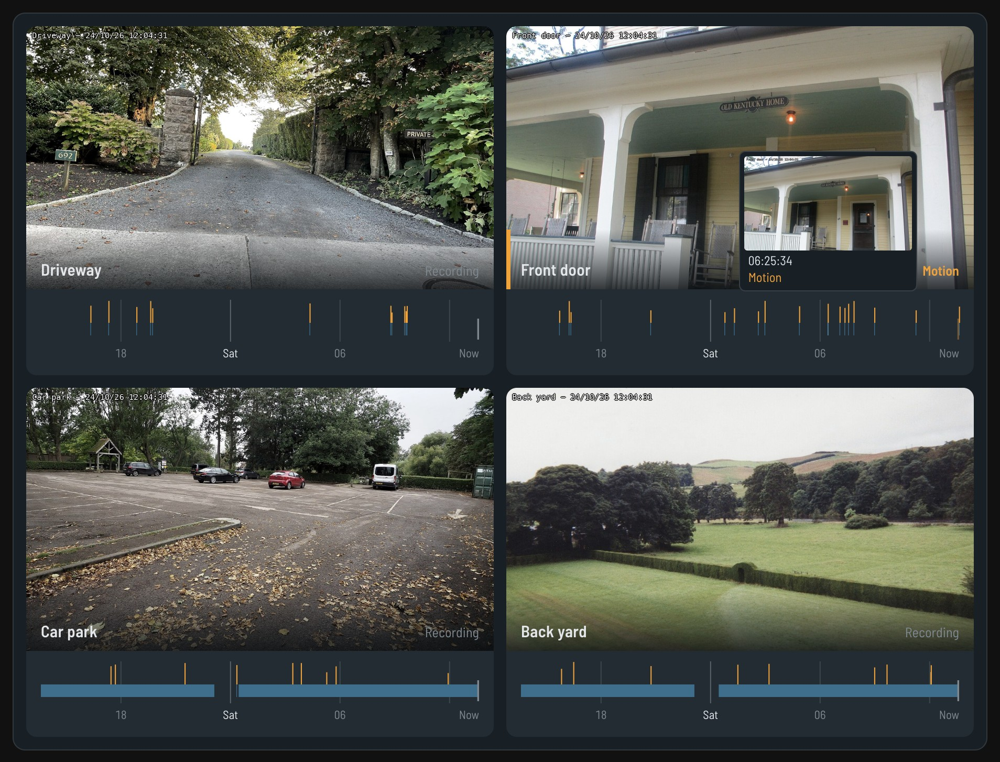
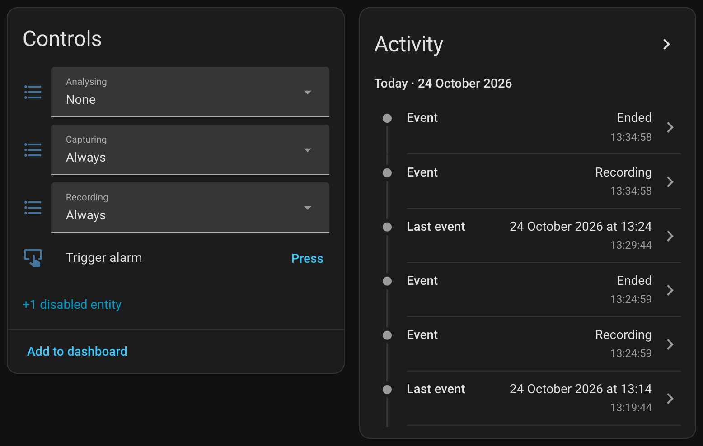
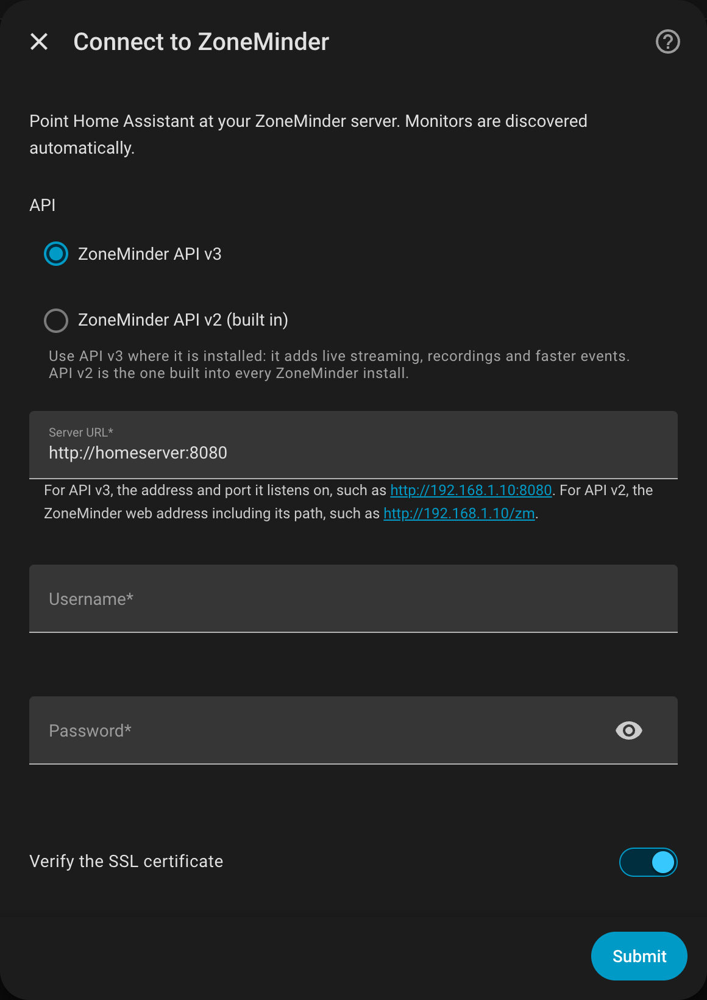

# ZoneMinder for Home Assistant

A Home Assistant integration for [ZoneMinder](https://zoneminder.com/): live cameras,
recordings you can browse and play, real-time motion, monitor controls and PTZ, all set
up from the UI.

[![HACS Custom][hacs-badge]][hacs]
[![Validate][validate-badge]][validate-workflow]
[![Tests][test-badge]][test-workflow]
[![License: Apache 2.0][license-badge]][license]



## What you get

- **Live cameras.** One camera entity per monitor, with WebRTC straight from ZoneMinder
  where API v3 offers it and HLS as the fallback. It works in every standard card, and
  no ZoneMinder token ever reaches the browser.
- **A camera card, installed for you.** Live view with a 24-hour strip under each
  camera showing when it recorded and when it saw motion. Click the strip to play from
  that moment. Add `type: custom:zoneminder-card` to a dashboard; there is no resource
  to register.
- **Phone notifications with a picture and the clip.** A bundled blueprint sends the
  picture when motion starts and adds a "Play clip" button when the recording ends.
  Each link opens that one event and nothing else.
- **Events with or without MQTT.** MQTT gets them to you in under a second. Without
  it, the integration checks every 5 seconds, so motion sensors, event entities and
  notifications still work.
- **Recordings in the media browser.** Every event shows up under Media > ZoneMinder,
  organised by camera and day, with thumbnails. Play them in the browser or cast them.
- **Motion that means motion.** Continuous recording doesn't register as motion.
- **Home and Away.** A run state select switches every camera at once, for
  presence-based arming. Save the current setup as a run state from Home Assistant.
- **Real monitor controls.** ZoneMinder 1.37 split the old Function dropdown into
  Capturing, Analysing and Recording, so you get one `select` for each.
- **NVR-level sensors.** Storage used, events today, capture rate, capture bandwidth,
  camera connection state, daemon health and version, on a ZoneMinder server device that
  the cameras hang off.
- **PTZ.** Pan, tilt, zoom, focus, home and stored presets, from the card or the
  `zoneminder.ptz` action.



## Requirements

- Home Assistant 2025.2 or newer
- ZoneMinder with either [ZoneMinder API v3](https://github.com/SteveGilvarry/zm-api)
  (recommended) or its built-in API v2 (ZoneMinder 1.36+)
- An internal Home Assistant URL set under Settings > System > Network, so live video can
  be proxied
- Optional: an MQTT broker, for events in under a second

Home Assistant installs [aiozoneminder](https://github.com/SteveGilvarry/aiozoneminder),
the client library this integration uses, automatically.

## Installation

### HACS

1. HACS > Integrations > three-dot menu > Custom repositories
2. Add `https://github.com/SteveGilvarry/zm-homeassistant` with category **Integration**
3. Install **ZoneMinder**, then restart Home Assistant

### Manual

```bash
cd /config
git clone https://github.com/SteveGilvarry/zm-homeassistant
cp -r zm-homeassistant/custom_components/zoneminder custom_components/zoneminder
```

Then restart Home Assistant.

### Adding the integration

**Settings > Devices & Services > Add Integration > ZoneMinder**, then fill in:

- **API**: ZoneMinder API v3, or API v2 (built into ZoneMinder)
- **Server URL**: `http://192.168.1.10:8080` for API v3, or `http://192.168.1.10/zm`
  for API v2
- **Username and password**
- **Use MQTT for real-time events**



## Choosing an API

|                | API v3 (default)                       | API v2 (built in)                   |
| -------------- | -------------------------------------- | ----------------------------------- |
| Talks to       | [ZoneMinder API v3](https://github.com/SteveGilvarry/zm-api) at `/api/v3` | ZoneMinder's CakePHP API at `/zm/api` |
| Auth           | JWT bearer, refreshed automatically    | Query-parameter token               |
| Default port   | 8080                                   | your ZoneMinder web port            |
| Live video     | WebRTC (WHEP), RTSP or HLS             | go2rtc RTSP, or MJPEG stills        |
| Recordings     | Yes: media browser, card, notifications | Not yet                            |
| Run states     | Switch and save                        | Switch                              |
| Server sensors | Storage, daemons, capture stats        | Version only                        |

API v3 gives you live video, recordings, storage and capture statistics that the built-in
API doesn't expose. Pick API v2 if you run a stock install and want to stay that way.

## Real-time events

Events reach Home Assistant two ways, and you only need one:

- **Polling, always on.** The integration asks ZoneMinder for its newest events every
  5 seconds and fires the same start and end notices MQTT would. Nothing to set up.
- **MQTT, optional and faster.** Under a second instead of up to 5.

When both are running, each event fires once: whichever source hears about it second is
ignored. Events that already existed when Home Assistant started are treated as history,
so a restart never sets off a notification.

To use MQTT, turn it on in ZoneMinder under **Options > MQTT**:

```
ZM_MQTT_HOSTNAME:  your-broker
ZM_MQTT_PORT:      1883
```

Then enable MQTT on each monitor, under its **MQTT** tab. This last step is easy to
miss, and without it ZoneMinder never publishes anything.

The topic prefix is read from ZoneMinder's own `ZM_MQTT_TOPIC_PREFIX` setting, so you
don't have to match its capitalisation by hand. Override it in the integration's options
if your broker is set up differently.

Object labels from zmeventnotification come through either way: over MQTT, or from the
`detected:` line it writes into the event notes.

## Motion, and why continuous recording is not motion

ZoneMinder opens an event whenever it records, whether or not anything moved. If a
monitor is set to record continuously, there is always an event in progress. Motion
sensors key on events with alarmed frames instead, and ignore MQTT notifications from
monitors that are not analysing.

If a motion sensor never turns on, check that the monitor's **Analysing** select is set
to `Always`. A monitor that only captures and records cannot detect anything.

## Live video

On API v3, each camera picks the best route the server offers:

1. **WebRTC, straight from ZoneMinder.** When the server has WHEP
   (`/api/v3/live/{monitor}/webrtc/whep`), Home Assistant passes the browser's offer to
   ZoneMinder and the video goes from ZoneMinder to the browser with nothing
   re-packaging it. HLS stays on offer, so a browser that can't reach ZoneMinder over
   WebRTC (away from home, with no TURN server) falls back to it. Running ZoneMinder in
   Docker? Set `streaming.webrtc.nat_ips` in API v3's config so it advertises an address browsers
   can reach.
2. **RTSP.** When API v3's RTSP server is on, cameras hand Home Assistant a signed,
   view-only RTSP link. Home Assistant's bundled go2rtc turns that into WebRTC.
3. **HLS through Home Assistant.** Always available. API v3 needs a bearer token on the
   playlist and every segment, which ffmpeg can't send, so the integration proxies the
   stream at `/api/zoneminder/...`. The proxy only serves media paths and is guarded by a
   secret that changes on every restart. This is why an internal URL must be set.

### go2rtc, on API v2

Set `ZM_GO2RTC_PATH` in ZoneMinder's options. The integration reads the stream list from
go2rtc and matches monitors to it, rather than guessing that stream names match monitor
ids, and it checks whether go2rtc's RTSP server is actually running before handing Home
Assistant an `rtsp://` URL. When RTSP is switched off, cameras fall back to stills.

## Recordings

Recordings appear under **Media > ZoneMinder**, by server, camera and day. Playback goes
through the same proxy, so no ZoneMinder credentials reach the browser.

## Home and Away (run states)

A ZoneMinder run state is a saved set of modes for every camera: "Away" might analyse
and record on motion everywhere, "Home" might only record the street. The ZoneMinder
server device gets a **Run state** select once there is more than the built-in
`default` to choose from. Switching it changes every camera at once, which is what
presence-based arming automations want.

To create one, set the cameras up the way you want, then call
`zoneminder.save_run_state` with a name. That needs API v3; on API v2, save run states in
ZoneMinder's web interface.

## Card

The integration installs a Lovelace card. Add it to any dashboard:

```yaml
type: custom:zoneminder-card
```

That shows every ZoneMinder camera. Each one shows live, with a strip underneath
covering the last 24 hours: blue where it recorded, amber where it saw motion. Hover
for a frame from that moment and click to play from there. Clips play on into the next
one, at 1×, 4× or 16×. Cameras ZoneMinder rotates are shown upright.

| Option     | Default                | What it does                                         |
| ---------- | ---------------------- | ---------------------------------------------------- |
| `entities` | all ZoneMinder cameras | Cameras to show, as entity ids or `{entity, name}`   |
| `columns`  | fits the width         | Fixed number of columns                              |
| `hours`    | 24                     | How far back the strip goes, 1 to 168                |
| `ptz`      | true                   | Show the pan and tilt pad on cameras that support it |

Tab to a strip to use the keyboard: Left and Right move a minute (ten with Shift), Home
and End jump to the start and to now, Enter plays, and Escape goes back to live.

If an older setup lists `/local/zoneminder-card.js` as a dashboard resource, remove it.
The card won't load twice, but that copy will go stale.

The card's source is in [`card/`](card/README.md).

## Actions

| Action                         | What it does                                            |
| ------------------------------ | ------------------------------------------------------- |
| `zoneminder.trigger_event`     | Forces a monitor into alarm, starting a recording       |
| `zoneminder.cancel_event`      | Clears a forced alarm                                   |
| `zoneminder.ptz`               | Pan, tilt, zoom, focus, home or go to a preset          |
| `zoneminder.set_monitor_state` | Changes capturing, analysing, recording or decoding     |
| `zoneminder.save_run_state`    | Saves every camera's current modes as a named run state |

## Notifications

Import `blueprints/automation/zoneminder/motion_notification.yaml`, or copy it into
`config/blueprints/automation/zoneminder/`. Pick the cameras and your phone's notify
action. When a camera sees motion you get a notification with a picture, and when the
recording finishes the same notification gains a "Play clip" button.

Each camera's event entity carries `thumbnail_url` and `clip_url` for its latest event,
so your own automations can use them too. Each link opens that one event and nothing
else, needs no login (phones fetch attachments without one), and keeps working after
Home Assistant restarts. The event entity fires `motion` (or `recording` on cameras
without analysis) when an event opens and `ended` when it closes.

## Troubleshooting

Download diagnostics from the integration's page first. Passwords, tokens and the
credentials embedded in camera RTSP URLs are stripped out, so it is safe to attach to an
issue.

| Symptom                        | Likely cause                                                     |
| ------------------------------ | ---------------------------------------------------------------- |
| Motion never turns on          | The monitor's Analysing is `None`                                |
| Motion takes a few seconds     | Normal without MQTT; set MQTT up for under a second              |
| WebRTC doesn't connect         | ZoneMinder advertises an address the browser can't reach; set `nat_ips` |
| Cameras show but do not play   | No internal URL set under Settings > System > Network            |
| No recordings in Media         | API v2, which doesn't serve them                                 |
| Device links go nowhere        | Set the ZoneMinder web address in the integration's options      |

## Development

```bash
python3 -m venv venv && source venv/bin/activate
pip install -r requirements_test.txt av PyTurboJPEG ha-ffmpeg
pytest
ruff check custom_components/zoneminder tests
```

See [docs/DEVELOPMENT.md](docs/DEVELOPMENT.md) for the local ZoneMinder and MQTT setup,
and [CONTRIBUTING.md](CONTRIBUTING.md) before opening a pull request.

## License

Apache-2.0. See [LICENSE](LICENSE).

[hacs]: https://github.com/hacs/integration
[hacs-badge]: https://img.shields.io/badge/HACS-Custom-41BDF5.svg
[validate-workflow]: https://github.com/SteveGilvarry/zm-homeassistant/actions/workflows/validate.yaml
[validate-badge]: https://github.com/SteveGilvarry/zm-homeassistant/actions/workflows/validate.yaml/badge.svg
[test-workflow]: https://github.com/SteveGilvarry/zm-homeassistant/actions/workflows/test.yaml
[test-badge]: https://github.com/SteveGilvarry/zm-homeassistant/actions/workflows/test.yaml/badge.svg
[license]: LICENSE
[license-badge]: https://img.shields.io/badge/License-Apache%202.0-blue.svg
